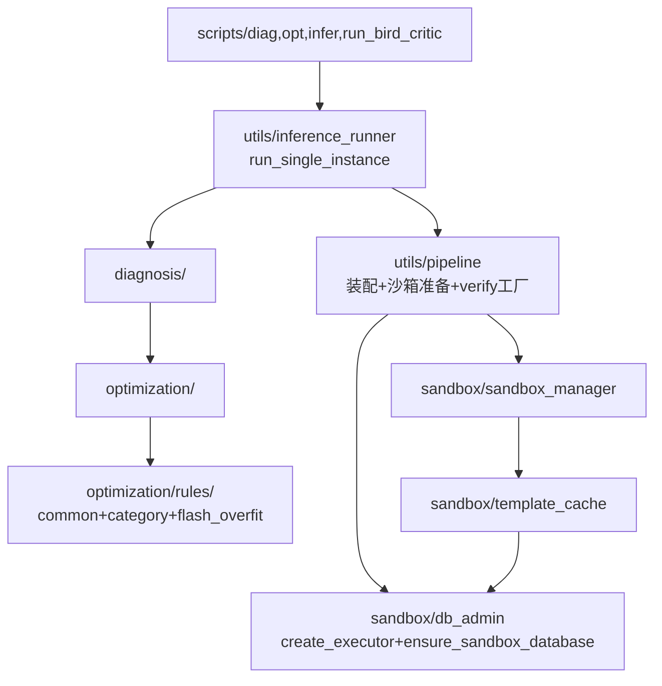

## 用户需求

在 Flash 200 评测达标（51.00%）后、推进后续阶段（PG 530 / Open-MySQL 全量、断言失败聚类、WebUI）前，对前序多轮 Agent patch 堆叠形成的代码架构做一次系统性治理。

**目标与边界**：

- 保证需求完成度不变：所有 CLI 参数、输出 JSONL 字段、打印格式、批跑语义（`--isolate subprocess` 默认、`--resume`、有 pred 不清空、`--limit` 约定）完全不变；推理/测试执行操作不大改
- 从可维护性、可用性、人类可读性、鲁棒性角度重构，不引入新框架/依赖
- 完善测试用例：重构前先补特征测试锁定现有行为，重构后必须全量通过才能验收
- 更新文档，删除过时内容

**已确认的三个决策**：

1. verify.py 单题过拟合规则：隔离到独立模块（如 `optimization/rules/flash_overfit.py`），注释标注题面特征来源，判定逻辑逐字不变
2. 验收方式：pytest 全量 + smoke 脚本（Docker 可用时）+ 用 `--ids` 复跑 2~5 条 Flash 题对比 pred 一致性（LLM 非确定性允许小差异）
3. diag.py 接入统一主链路（获得抽表校验回退 + 模板缓存增强，CLI 参数与输出格式不变）

## 核心功能内容

1. **消除四份重复主链路**：diag.py / opt.py / infer.py / run_bird_critic.run_one 收敛为单一推理服务，CLI 薄壳化
2. **verify.py 瘦身**：300 行巨型函数拆为「执行信号主流程 + 规则注册表循环」，单题规则显式隔离分层
3. **patch 残留清理**：死变量/死参数/死分支、双份重复代码、SQL 转义错用、循环依赖、缩进错乱
4. **测试体系扩展**：覆盖全部 verify 规则函数、pipeline 纯函数、批跑记录函数、优化图路由与 fallback
5. **文档同步**：架构说明书、AGENTS.md、过程文档与重构后代码一致

**视觉效果**：无 UI 变化（纯后端/工程治理）；效果体现为代码行数下降、单文件职责单一、测试可回归。

## Tech Stack

- 沿用现有栈：Python 3.x + LangChain/LangGraph + psycopg2/PyMySQL + pytest；**不引入任何新依赖**
- 测试：pytest（纯单元测试，无需 DB/LLM key）；smoke 脚本复用现有 `scripts/smoke_*.py`
- 文档：Markdown，中文，遵循 AGENTS.md 约定（勿擅自 git 提交）

## Implementation Approach

**总策略：测试先行 + 行为保持 + 渐进式小步重构**。每个模块重构前先有特征测试（characterization test）锁定行为，重构中判定逻辑逐字搬运（只允许搬运与包装，不允许改写），每完成一个模块跑一次全量 pytest。verify 规则迁移用「同一输入下新旧函数输出全等」的 golden 对比保障。

**重构后的模块关系**（打破 template_cache ↔ pipeline ↔ sandbox_manager 循环依赖）：



**关键决策与理由**：

1. **统一主链路放 `utils/inference_runner.py`**（而非扩展 pipeline.py）：以 `run_bird_critic.run_one` 为蓝本抽取（它是最新的实现：含 mode/slot/timing/prior_pred/完整清理），pipeline.py 保持「装配与工厂」职责，避免单文件超 700 行
2. **规则注册表而非继续 if 链**：`Rule.check(ctx) -> Optional[否决消息]`，类目过滤在注册表元数据声明；执行/超时/Soft EX/QEP 属于测量主流程保留在 Verifier，不走规则（它们有严格的执行顺序依赖）
3. **db_admin 下沉到 sandbox/**：create_executor / ensure_sandbox_database 是沙箱域的底层能力，下移后 pipeline / template_cache / sandbox_manager 统一单向依赖它
4. **性能零回归**：规则注册表为模块级常量列表（构建一次），无反射/查找开销；批跑热路径（有界在飞、流式去重、subprocess 强杀）逻辑原样搬运

## Implementation Notes

- **语义逐字保留红线**：`rules/*.py` 中函数体从 verify.py 原样搬运（含正则、消息文案中文措辞），仅外层包 Rule 适配；测试中对每条规则用原 verify.py 导入路径做 golden 对比后再切换
- **兼容性**：`GatedChatOpenAI` 别名先全局搜索引用，无引用则删；config 键（含 first_token_timeout）读取逻辑保留；`run_bird_worker.py` 改为 import `utils/inference_runner` + `utils/batch_records`
- **风险控制**：`ensure_sandbox_database` PG 转义修复、MySQL 清理 SQL 转义修复仅影响含引号的异常库名（实际配置不触发），风险≈0；`run_one` 迁移时 finally 清理顺序保持（template release → cleanup → close target → close sandbox）
- **性能注意**：LLM 重试骨架合并时保留全部重试日志/timing 埋点文案；不许在规则循环中引入重复的正则重编译（模块级预编译常量随函数搬运）
- **日志**：沿用 default_logger 与现有级别；`_veto` 辅助统一 errors+failure_reasons 追加，不新增日志 spam

## Directory Structure

```
AstraTune/
├── utils/
│   ├── jsonl_io.py           # [NEW] JSONL 读写/流式去重/合并过滤（自 pipeline.py 迁出，纯函数）
│   ├── table_resolution.py   # [NEW] 表名规范化/schema 解析/抽表校验回退链（自 pipeline.py 迁出）
│   ├── inference_runner.py   # [NEW] 统一单条推理 run_single_instance()（自 run_bird_critic.run_one 抽取为蓝本）
│   ├── batch_records.py      # [NEW] 批跑记录纯函数：has_pred_sqls/is_inference_success/slim/finalize/fallback_row/load_done_ids/_summarize/_parse_worker_stdout（自 run_bird_critic.py 迁出）
│   ├── pipeline.py           # [MODIFY] 保留 setup_executors/prepare_sandbox/make_* 工厂；删 used_template 死变量、make_verify_fns/make_reset_fn 死参数、无效三元分支；顶部统一 import
│   └── llm.py                # [MODIFY] 抽公共 _retry_loop 骨架合并 sync/async 双份 55 行重复；删 first_token_timeout 死参数（配置键读取保留）；按引用检查结果处理 GatedChatOpenAI 别名
├── optimization/
│   ├── rules/
│   │   ├── __init__.py       # [NEW] Rule/RuleContext 定义 + 注册表 ALL_RULES + 按类目筛选
│   │   ├── common.py         # [NEW] 跨类目通用：missing_intent_tables、missing_preprocess_created_tables、pg_delete_update_limit、mysql_dialect_funcs_in_pg、conditional_count_without_filter、query_output_example_mismatch
│   │   ├── category.py       # [NEW] 类目级启发：personalization_group_key_only、pers_streak_histogram_mismatch、upsert_operation_type_mismatch、on_conflict_index_mismatch、returning_join_mismatch、efficiency_merge_notin、mgmt_trigger_incomplete
│   │   └── flash_overfit.py  # [NEW] 单题规则（docstring 标注题面特征来源）：query_time_format_mismatch、table_count_uses_count_column、consecutive_date_island_count、circular_fk_chicken_egg、next_free_date_mismatch、mgmt_trigger_incomplete 的 WebsiteUrl 分支（若可独立拆出）。归类原则：函数体含特定表名/列名/题面特征词 → 此模块；执行时按此原则微调归属，语义不变
│   ├── verify.py             # [MODIFY] 瘦身：保留执行/超时/Soft EX/QEP 主流程 + _verify_one_candidate + 规则循环 + _veto 辅助；原规则函数体迁出
│   └── graph.py              # [MODIFY] 修复 generate_node 缩进错乱（line 98-111）；verify_node 拆出 _apply_agent_verdicts；路由与 fallback 逻辑不变
├── sandbox/
│   ├── db_admin.py           # [NEW] create_executor + ensure_sandbox_database（自 pipeline.py 下沉；修复 PG CREATE DATABASE 双引号转义错用）
│   ├── sandbox_manager.py    # [MODIFY] 顶部统一 import（消除 6 处函数内 MySQLExecutor import）；修复 _cleanup_mysql_database SQL 拼接转义与 DROP TABLE 反引号转义；裸 except 收敛；_batch_copy_data 扁平化
│   └── template_cache.py     # [MODIFY] 删 `if False else` 死代码；合并 _drop_database/drop_slot_database 重复 ~30 行；_snapshot_slot_to_template PG 分支 try/close 去重；改依赖 sandbox.db_admin
├── scripts/
│   ├── diag.py               # [MODIFY] 薄壳化：参数解析 + 调用统一链路（接入抽表校验回退 + 模板缓存，CLI/输出不变）
│   ├── opt.py                # [MODIFY] 薄壳化，同上
│   ├── infer.py              # [MODIFY] 薄壳化（保留 --stream 诊断流式输出路径）
│   ├── run_bird_critic.py    # [MODIFY] 只留编排：parse/load_records/preflight/有界在飞调度/汇总；`__import__("threading")`→顶部 import；_timeout_row 更名 _fallback_row；删空 if 与未用 import；_run_batch 拆出调度函数
│   └── run_bird_worker.py    # [MODIFY] 改 import utils.inference_runner + utils.batch_records（不再从 run_bird_critic 导入）
├── tests/
│   ├── test_verify_rules.py  # [NEW] 全部规则函数 2~4 用例（触发/不触发/边界）+ golden 对比
│   ├── test_pipeline_tables.py # [NEW] resolve_and_validate_tables 三级回退链（mock executor）、schema_tables_mentioned_in_text、tables_from_schema_text、sandbox_db_name_for_slot、make_reset_fn 智能跳过
│   ├── test_batch_records.py # [NEW] finalize_inference_record（有 pred 不清空）、slim_output_record、fallback_row、load_done_ids（resume/rerun-nonok）、_summarize、_parse_worker_stdout
│   ├── test_opt_graph.py     # [NEW] 注入假 GenerateAgent/Verifier/verify_agent：route_after_verify 边界、VerifyAgent 否决假过、轮次耗尽 fallback 三级顺序
│   └── test_jsonl_io.py      # [NEW] dedupe_jsonl_by_id 流式去重、merge_schema_and_input、filter_by_dialect
├── docs/架构说明书.md         # [MODIFY] §2 模块地图、§4.4 规则分层小节、§6.1 单条入口说明更新
├── AGENTS.md                 # [MODIFY] 代码地图同步 + flash_overfit 警示
└── docs/过程文档.md           # [MODIFY] 追加「2026-08 架构重构记录」章节（不重写历史）
```

## Key Code Structures

```python
# optimization/rules/__init__.py —— 规则注册表核心接口
@dataclass(frozen=True)
class RuleContext:
    dialect: str                 # 小写规范化方言
    category: str                # 小写规范化类目
    query: str
    schema: str
    pred_sqls: List[str]
    preprocess_sql: List[str]
    rows: Optional[List[Any]] = None   # 候选执行结果行（query_output_example_mismatch 等需要）

@dataclass(frozen=True)
class Rule:
    id: str                      # 如 "pg_delete_update_limit"
    categories: frozenset        # 适用类目；frozenset() = 全类目
    source: str                  # "common" | "category" | "flash_overfit:<特征描述>"
    check: Callable[[RuleContext], Optional[str]]  # 返回否决消息文案或 None（逐字沿用现有文案）
```

```python
# Verifier 内规则循环（替换现有 20+ if 三连否决）
def _apply_rules(self, cand, rows) -> None:
    ctx = RuleContext(dialect=self.dialect, category=self.category.lower(),
                      query=self.query, schema=self.schema,
                      pred_sqls=list(cand.pred_sqls),
                      preprocess_sql=self.preprocess_sql, rows=rows)
    for rule in rules_for(ctx.category):          # 模块级预筛，零运行时开销
        msg = rule.check(ctx)
        if msg and ctx.category in rule.categories or not rule.categories:
            self._veto(cand, msg)                 # errors+failure_reasons 追加，语义同现有三连
```

## Agent Extensions

### SubAgent

- **code-explorer**
- Purpose：在统一主链路任务执行前，完成三项影响面确认——(1) `scripts/opt.py` 完整结构与独立逻辑清单；(2) `GatedChatOpenAI` 别名与 `utils/pipeline` 各函数的全局引用点；(3) 各 CLI 脚本对 pipeline/llm 的 import 依赖清单
- Expected outcome：产出「引用影响面清单」，确保薄壳化与别名删除不遗漏任何调用点，避免重构后 import 断裂