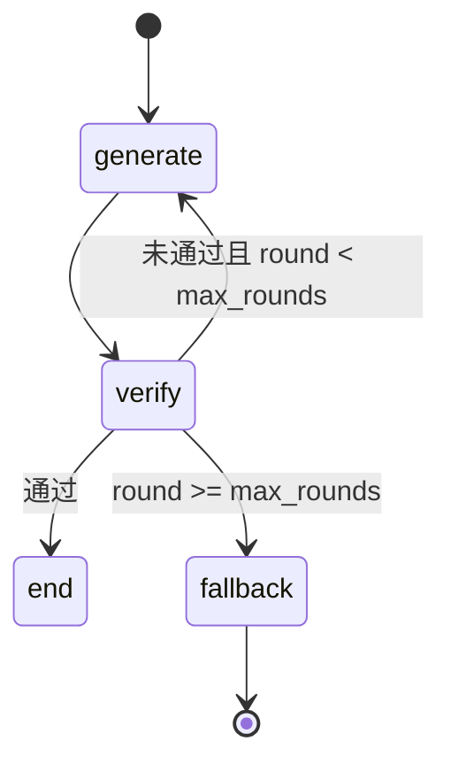

# AstraTune 架构说明书

> 版本：2026-08-24（Flash 200 达标后架构重构版；批跑 subprocess 隔离）  
> 规格锚点：`docs/spec_acc.md`（Flash ≥50% **已达标**；val28 ≥60% 已过）；评测报告 `docs/flash200评测报告.md`

本文档固化当前代码实现的设计意图与机制细节，供后续 Agent / 开发者快速建立一致心智模型。

---

## 1. 系统定位与边界

AstraTune 是基于大模型与多智能体协同的 **SQL 问题诊断与修复** 系统。研究叙事可面向卫星互联网，**实现泛化为通用 SQL**（语法/语义/方言/DDL/性能）。实验基准为 **BIRD-CRITIC**。

**端到端主链路**：

```text
题面 (issue_sql, query, schema, preprocess/clean_up)
  → 诊断 Agent（ReAct + 沙箱）
  → 诊断报告【诊断结论】
  → Generate–Verify 多智能体
  → pred_sqls（list[str]）
  → merge sol → 官方 wrapper 评测
```

**刻意不做**：RAG、Reflect、微调管线、达梦沙箱、Verify 硬拦 DDL/DML（安全靠沙箱隔离）。

**两套「库」概念（易混）**：


| 概念                    | 角色                                                     |
| --------------------- | ------------------------------------------------------ |
| **目标库 target**        | BIRD 模板库 / 生产库；抽表、抽 schema、采样源                         |
| **沙箱 sandbox**        | Agent 诊断与 Verify 操作的隔离库；从 target 拷贝或采样                 |
| **评测 ephemeral copy** | 官方 wrapper 在独立副本上跑 pred + test_cases；Agent **不直接写评测库** |


---


## 2. 目录与模块地图


| 路径                               | 职责                                                     |
| -------------------------------- | ------------------------------------------------------ |
| `diagnosis/`                     | 诊断 ReAct 图、prompt、Agent 入口                             |
| `optimization/`                  | Generate–Verify 图、规则 Verify、Verify Agent               |
| `optimization/rules/`            | Verify 否决规则注册表（`common` 通用 / `category` 类目启发 / `flash_overfit` 单题规则） |
| `sandbox/db_admin.py`            | 沙箱域底层：执行器创建、槽位库名、建库（pipeline/template_cache/sandbox_manager 单向依赖它） |
| `sandbox/`                       | PG/MySQL 执行器、SandboxManager、统计注入、模板缓存                  |
| `tools/sandbox_tool.py`          | LangChain 工具：`execute_sql`、`reset_sandbox_environment` |
| `utils/inference_runner.py`      | **统一单条推理链路** `run_single_instance()`：抽表→沙箱→诊断→优化→pred（四入口共用） |
| `utils/pipeline.py`              | JSONL IO、表名解析/抽表校验回退、执行器装配、沙箱准备、Verify 用 reset/execute/explain 工厂 |
| `utils/batch_records.py`         | 批跑记录纯函数：done 判定、slim/finalize、兜底行、worker stdout 解析、汇总    |
| `utils/llm.py`                   | ChatOpenAI 工作池（`llm_key_mode=auto\|single`；等池超时 180s） |
| `utils/sandbox_fidelity.py`      | 沙箱保真度清单（采样/统计注入）文本化                                    |
| `utils/batch_preflight.py`       | 批跑前磁盘/单实例/Docker 门禁                                    |
| `scripts/diag.py`                | 单条诊断（薄壳：调统一链路 mode=diag_only）                         |
| `scripts/opt.py`                 | 单条优化（薄壳：mode=opt_only + --diagnosis）                  |
| `scripts/infer.py`               | 单条端到端（薄壳：mode=diag+opt / opt_only）                    |
| `scripts/run_bird_critic.py`     | BIRD 批量推理编排（默认 `--isolate subprocess`；单题链路走 inference_runner） |
| `scripts/run_bird_worker.py`     | 单题子进程：超时可被父进程强杀                                      |
| `scripts/slim_pred_jsonl.py`     | pred 去重 + 诊断报告截断                                      |
| `scripts/merge_pred_with_sol.py` | pred + sol 合并为 eval_ready                              |
| `scripts/run_official_eval.py`   | 官方 wrapper 封装                                          |
| `config/*.json`                  | LLM、沙箱、批并发、Verify 模式                                   |


---


## 3. 诊断模块（Diagnosis）


### 3.1 设计目标

在**不看标准答案**的前提下，结合题面、用户问题、schema 与沙箱探测，输出结构化 **【诊断结论】**，为 Generate 提供可操作的修复方向（表/列/索引/语义/方言/DDL/性能等）。

### 3.2 流程

1. **抽表**（`extract_involved_tables`）：独立 LLM 调用，**不挂工具**；输入 issue_sql + 用户问题；输出 `{"tables":[...]}`。
2. **表名校验**（`resolve_and_validate_tables`）：与 target 库求交；合并用户问题点名的 schema 表；必要时回退 `original_schema` / 全库基表（≤40 张）。
3. **搭沙箱**（`prepare_sandbox`）：cleanup + setup（见 §5）。
4. **前置 SQL**：`SandboxTool.apply_preprocess_once()`，**只执行一次**（避免 Flash 题面 CREATE 重复导致 already exists / aborted）。
5. **ReAct 循环**（`diagnosis/graph.py` + LangGraph）：
  - 工具：`execute_sql`、可选 `reset_sandbox_environment`
  - 终止：输出含 `【诊断结论】` 或达 `max_iter` → `force_end` 强制要求结论（避免空回复静默 END）
6. 诊断结束；清理 SQL **不自动跑**（Agent 或后续 Verify 按需执行）。


### 3.3 沙箱工具策略（为何这样设计）


| 决策                        | 原因                                              |
| ------------------------- | ----------------------------------------------- |
| 前置只跑一次                    | Flash 过半 preprocess 含 CREATE/ALTER；每轮工具重跑必炸     |
| execute 用 autocommit      | 多语句批中一条失败不拖死整段会话                                |
| `\d` / `sqlite_master` 改写 | Agent 常混用 psql/SQLite 习惯；PG 沙箱需可执行替代            |
| INERROR 先 rollback        | 避免 `current transaction is aborted` 连环失败        |
| reset 高门槛                 | full reset 代价大（拷贝/采样+统计）；仅不可逆破坏且 clean_up 无法恢复时 |


### 3.4 配置

`config/agents.json` → `diagnosis.agent`：`max_iter`、`temperature`、`enable_test`、LLM endpoint。

---


## 4. 优化模块（Generate–Verify）


### 4.1 设计目标

将诊断报告转化为 **pred_sqls**（按序执行的 body SQL），在沙箱中经规则 + Verify Agent 双重把关，多轮迭代直至通过或 fallback。

**无 Reflect**：失败原因通过 `failure_reasons` 与 `round_history` 回灌 Generate；轮次耗尽由 VerifyAgent `select_final` 综合仲裁。

### 4.2 状态图（`optimization/graph.py`）




**OptState 关键字段**：

- `round` / `candidates` / `verify_report`
- `failure_reasons`：当前轮汇总否决原因（喂给下轮 Generate）
- `round_history`：各轮候选 + rules/agent 否决摘要（Generate 与最终仲裁可见）
- `sandbox_fidelity`：保真度文本块


### 4.2.1 Intent Spec（2026-08-24）

- 模块：[`optimization/intent_spec.py`](../optimization/intent_spec.py)
- 时机：诊断完成后、`run_optimization` 前（[`utils/inference_runner.py`](../utils/inference_runner.py)）
- 输出：结构化 JSON（goal / output_columns / agg_filters / mgmt_artifacts / evidence 等）；解析失败 fail-open
- Generate 以 `## Intent Spec (JSON)` 为硬约束；system prompt 已瘦身为薄协议

### 4.3 Generate Agent

- 单次 LLM 调用，输出 JSON `{ "candidates": [{ id, pred_sqls, rationale, strategy_tag }] }`
- 读入 `Intent Spec` + `failure_reasons` + `round_history`
- 后处理：[`optimization/strategy_slots.py`](../optimization/strategy_slots.py) 按类目补齐 strategy_tag 槽位


### 4.4 Verify（规则层 `optimization/verify.py`）

对每个候选，在 **preprocess → body → clean_up** 包裹下执行：


| 信号                          | 用途                 |
| --------------------------- | ------------------ |
| 执行成败 / 超时                   | 硬否决                |
| Soft EX（仅 Efficiency）       | 与 issue_sql 结果集合比较 |
| QEP cost                    | Efficiency 排序；**采样沙箱下 `qep_hard_gate=False`，不硬否决** |
| 题意表名 / Pers 代表行 / Query 投影等 | 规则硬约束或启发           |

**规则注册表**（`optimization/rules/`，2026-08 重构引入）：规则函数按三层模块组织，`Rule.check(ctx) -> Optional[否决消息]`，Verifier 内按注册顺序循环判定（单条否决即短路，与历史 if 链行为一致）：

| 层                      | 内容                                                     |
| ---------------------- | ------------------------------------------------------ |
| `rules/common.py`      | 跨类目通用：意图表缺失、preprocess 新表缺失、PG DELETE/UPDATE LIMIT、charindex 残留、条件计数 FILTER、题面输出样例 |
| `rules/category.py`    | 类目启发：Pers 分组键假修复/直方图、Mgmt UPSERT 标签/ON CONFLICT 索引/RETURNING JOIN/触发器完整性、Eff 双 NOT IN 合并 |
| `rules/spec_rules.py`  | **Intent Spec 驱动泛化规则**（输出契约、谓词落地、Pers 代表行、Mgmt artifacts） |
| `rules/flash_overfit.py` | **单题过拟合规则（冻结新增）** |

- 注册顺序 = 历史执行顺序（`rules/__init__.py::ALL_RULES`），保证 errors/failure_reasons 顺序不变
- `verify.py` 对规则函数名保持再导出（向后兼容 `from optimization.verify import <fn>`）
- 新增规则流程：在对应层实现 `check(ctx)` → 注册 `Rule(id, categories, source, check)` → `tests/test_verify_rules.py` 补触发/不触发用例

**智能 reset**（`utils/pipeline.make_reset_fn`）：

- 默认 `verify_isolation=smart_reset`
- 脏标记：执行过可能改数据/结构的 SQL 才 `cleanup+setup`
- 纯 SELECT/EXPLAIN 链跳过全量重建 → 大幅降延迟

每条候选验证前调用 reset（smart 或 force）；Verify Agent 也可 `reset_fn(force=True)`。

### 4.5 Verify Agent（`optimization/verify_agent.py`）

模式：`verify_mode=agent+rules`（默认）

1. 规则层产出 `CandidateVerifyResult` 作为**确定性信号**
2. Verify Agent LLM 读题面 + 信号 + **round_history**，输出 `{ verdicts: [{ id, pass, feedback }] }`
3. **可否决假过**（rules_passed=true 但投影/格式/题意错）
4. **不可**把「执行失败」改成通过
5. 评判前可选 **reset 工具探测**（LLM 最多调用一次 `reset_sandbox_environment`）
6. **轮次耗尽**：`select_final` 读全部 `round_history`，输出最终 `pred_sqls`

**共识早停门禁**（[`optimization/consensus.py`](../optimization/consensus.py)）：Verify 通过后若多候选结果分裂或首轮 Spec 置信不足，不得 `success` 早停，强制再生成。

降级：`verify_mode=rules_only` 或 VerifyAgent 初始化失败。

### 4.6 Fallback 顺序

1. VerifyAgent `select_final`（综合各轮）
2. 启发式：`relative_best` 且无「执行失败」的候选
3. 回退 `issue_sql`

---


## 5. 沙箱模块（Sandbox）


### 5.1 SandboxManager

**setup_sandbox(tables)**：

1. 对每张表：行数 ≤ `copy_threshold` → 全量拷贝；否则采样（PG 优先 `TABLESAMPLE SYSTEM`）
2. `inject_statistics`：把 target 侧统计信息注入 sandbox（失败不阻断，记入 fidelity）
3. 返回 `sandbox_info` + `fidelity` 结构（供 Diag/Generate/Verify 透明）

**cleanup_sandbox**：

- MySQL：关 FK → 逐表 DROP → 开 FK
- PG：`DROP SCHEMA public CASCADE` + `CREATE SCHEMA public`（**全部 autocommit**）+ `CHECKPOINT`
- 清理前 `_ensure_sandbox_executor_ready`：rollback / 重连，避免 aborted 或 autocommit 残留

**reset_sandbox(tables)**：优先从只读**模板库**恢复本槽位（见 §5.4）；否则 `cleanup_sandbox` + `setup_sandbox`。

### 5.2 执行器（`pg_executor` / `mysql_executor`）

- 多语句拆分（尊重引号 / dollar-quote）
- PG：`execute_autocommit` 用于 DDL/CHECKPOINT/CREATE DATABASE
- 连接断开时尝试重连


### 5.3 保真度（`utils/sandbox_fidelity.py`）

`format_fidelity_text` 生成人类可读块，说明：

- 哪些表被采样、采样方法、行数
- 统计注入 ok/fail/skip
- preprocess 是否已应用

**设计原因**：采样下 Efficiency 耗时不可信、EXPLAIN 可能因统计注入失败失真；Agent 不应过度自信。

### 5.4 模板缓存（copy-on-write 槽位）

按 `(dialect, db_id, 表集合, copy_thr, sample_size)` 在沙箱实例上保留只读模板库 `astratune_tpl_*`（默认最多 4 个，LRU 淘汰）。

- **首次**：仍从 target 采样/全量拷贝 + `inject_statistics`（保真步骤不跳过），再快照到模板。
- **之后 / Verify reset**：把模板拷到当前 worker 的**独立槽位**（MySQL：同实例 `CREATE TABLE LIKE` + `INSERT SELECT`，命中后可并行；PG：`CREATE DATABASE ... TEMPLATE`，对模板短暂串行）。
- 模板只读；并行实例只写自己的 `astratune_sandbox_{slot}`，禁止共享可写库、禁止 DROP 对方槽位。
- 耗时日志前缀 `[timing]` / `[timing-summary]`（`utils/timing.py`）。端到端墙钟主因是诊断/Generate/Verify 的 LLM；Verify 仅在规则信号像沙箱损坏时才探测 reset。
- LLM 超时分层：诊断 `response_timeout=120s`；Generate/Verify `360s`；`max_attempts=4`；httpx 硬超时 +10s。沙箱 `--workers` 与 LLM 池独立。当前默认 `llm_key_mode=auto` + `llm_workers=4`（多 key 优先；单 key 时同一 key 扩成 4 槽）。排队记 `llm_pool_wait`（等池超时 180s）。

---


## 6. 推理与批跑（Inference）


### 6.1 单条入口


| 脚本         | 路径                    |
| ---------- | --------------------- |
| `diag.py`  | 仅诊断                   |
| `opt.py`   | 需 `--diagnosis` 或报告文件 |
| `infer.py` | 诊断 → 优化 → 打印 pred     |


三个 CLI 均为**薄壳**（2026-08 重构）：参数解析 + 打印，统一调用 `utils/inference_runner.run_single_instance()`（`mode=diag_only / opt_only / diag+opt`）。链路内含抽表校验回退、模板缓存、finally 统一资源释放（模板绑定 → 沙箱 → 双连接）。`run_bird_critic.run_one` 同样走该链路（额外做 record 合并 + `finalize_inference_record`）。

### 6.2 批量 `run_bird_critic.py`

- 合并 schema/input JSONL，按 dialect / ids / limit 过滤
- `--workers`：沙箱槽位 / 题目并发（`astratune_sandbox_{slot}`），与 LLM 无关；调度为**有界在飞**（只维持 `workers` 个 future）
- `--isolate`（默认 **`subprocess`**）：每题走 `run_bird_worker.py` 子进程；`instance_timeout_s`（默认 2400）到期 **kill 强杀**，写 timeout/fallback 行后继续下一批。`inproc` 仅调试用（挂住不可杀，易假死）
- LLM 工作池：`utils/llm.py`；subprocess 模式下**主进程不建池**，子进程各 1 槽；同步 invoke 超时后 `shutdown(wait=False)`，避免 hung HTTP 占满 worker
- `--resume`：跳过 output 中 **Verify 成功或已有非空 pred** 的 id；启动时流式去重
- 交付语义：`finalize_inference_record`（`utils/batch_records.py`）— **有 pred 禁止清空**；`hard_fail` 仅真空候选/异常；超时可保留 prior pred
- 写出：`slim_output_record`（诊断报告截断）；收尾 `dedupe_jsonl_by_id`（流式，避免整文件重写卡死）
- `preflight_batch_inference`：
  - D: 剩余 < 2GB → **中止**
  - D: 剩余 < 30GB → WARNING
  - 检测其它 `run_bird_critic` 进程 → 中止（`--force-batch` 可 override）
  - 批次锁文件 `{output}.batch.lock`
  - PG 5433 不可达 → WARNING

### 6.3 卡死与磁盘（运维要点）

**假死根因（已修）**：线程池超时不能强杀 → 僵尸任务占 LLM/沙箱槽；全量 future 一次性入队；巨型 `diagnosis_report` 撑爆 JSONL/终端。

Docker Desktop WSL 虚拟盘 `docker_data.vhdx` 会**虚胖**；`docker system df` 可能严重低估。

**跑批前**：确认 D: ≥30–50GB 余量。  
**跑批后若告急**：

1. `docker compose down`
2. 可选 `scripts/reclaim_sandbox_disk.py`
3. 退出 Docker Desktop → `wsl --shutdown`
4. **管理员** `scripts/compact_docker_vhdx.ps1`
5. 重启 Docker + compose

---


## 7. 评测对接（Evaluation）


### 7.1 流程

```text
pred.jsonl  →  merge_pred_with_sol.py  →  *_eval_ready.jsonl
  →  run_official_eval.py  →  wrapper_evaluation_*.py  →  report + accuracy
```


### 7.2 `--limit` 约定（`docs/评测对接.md` §2.1）

- **省略** `--limit`：对 JSONL **全量**评测（推荐）
- 显式 `--limit N`：仅前 N 条（调试）；不足全量时 WARNING

**禁止**：用小于全量的 limit 报准确率。

### 7.3 Agent 与 sol 隔离

推理阶段 **不得** 读取 `sol_sql` / gold；merge 阶段才合入 sol 供官方脚本使用。

---


## 8. 配置要点（`config/agents.json`）


| 键                                        | 含义                                                    |
| ---------------------------------------- | ----------------------------------------------------- |
| `diagnosis.agent`                        | 诊断 LLM、max_iter、enable_test                           |
| `optimization`                           | max_rounds、num_candidates、exec_timeout_ms、verify_mode |
| `optimization.verify.llm`                | Verify Agent 专用 LLM（可覆盖 optimization.llm）             |
| `batch.default_workers` / `max_workers`  | 沙箱槽位并发（与 LLM 池独立）                                   |
| `batch.llm_workers`                      | `4`：LLM 池 worker 数；单 key 时可复用同一 key              |
| `batch.llm_key_mode`                     | `auto`（默认）：优先 `OPENAI_API_KEYS`；`single` 仅用 `OPENAI_API_KEY` |
| `batch.instance_timeout_s`               | 单题墙钟超时（默认 2400；subprocess 下强杀）                     |
| `batch.sandbox_db_prefix`                | 多 worker 槽位库前缀                                        |
| `sandbox.copy_threshold` / `sample_size` | 拷贝 vs 采样                                              |


---


## 9. 扩展点（Flash 达标后）

- Query / Personalization 断言失败 → 算法优化（见 `docs/flash200优化方案.md`；少 prompt 规则注入）
- val28 全量漂移题（5,55,68,129）与 Efficiency **62** 超时
- WebUI（P2）：单条 diag→opt→pred 可视化
- PG/Open-MySQL 全量评测
- Docker：AstraTune `docker/` 与 BIRD evaluation **两套独立**，不合并

---


## 10. 关键设计原则（总结）

1. **沙箱即安全边界**：Allow DDL/DML in sandbox；靠隔离而非静态拦截。
2. **确定性信号 + LLM 评判**：规则可复现、可消融；Agent 补语义与假过检测。
3. **失败可回灌**：failure_reasons + round_history 形成闭环，无 Reflect。
4. **保真度透明**：采样/统计注入不隐瞒，避免 Efficiency 虚假通过。
5. **批跑可运维**：子进程隔离+超时强杀、磁盘/单实例/锁，避免假死与 Docker 静默失败。
6. **评测可复现**：全量 limit、pred/sol 分阶段、官方 wrapper 不改逻辑。
7. **交付完整**：有 pred 不清空；hard_fail 仅真空候选。
8. **测试锁定行为**：规则/纯函数/图路由均有特征测试（`tests/`，165 用例）；新机制进独立模块，重构时先锁行为再动结构。

