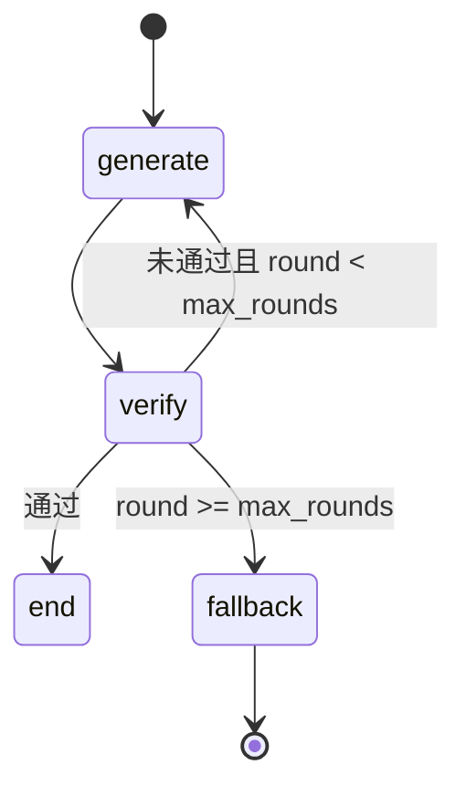

# AstraTune 架构说明书

> 版本：2026-08-25（对照现行代码；PG 530 正式 **51.13%**）  
> 规格锚点：`docs/spec_acc.md`；评测报告 `docs/pg530评测报告.md`；进度 `docs/过程文档.md`

本文档固化当前代码的设计意图与机制细节，供后续 Agent / 开发者建立一致心智模型。**以仓库代码为准**；配置数值以 `config/*.json` 现行值为准（括号内为 loader fallback）。

---

## 1. 系统定位与边界

AstraTune 是基于大模型与多智能体协同的 **SQL 问题诊断与修复** 系统。研究叙事可面向卫星互联网，**实现泛化为通用 SQL**（语法/语义/方言/DDL/性能）。实验基准为 **BIRD-CRITIC**（现行正式成绩：PG 530）。

**端到端主链路**：

```text
题面 (issue_sql, query, schema, preprocess/clean_up)
  → 抽表 → 沙箱
  → 诊断 Agent（ReAct + 沙箱，可选）
  → extract_intent_spec
  → Generate–Verify 多智能体
  → pred_sqls（list[str]）
  → merge sol → 官方 wrapper 评测
```

**刻意不做**：RAG、Reflect、微调管线、达梦沙箱、Verify 硬拦 DDL/DML（安全靠沙箱隔离）。

**三套「库」概念（易混）**：

| 概念 | 角色 |
| ---- | ---- |
| **目标库 target** | BIRD 模板库 / 生产库；抽表、抽 schema、采样源 |
| **沙箱 sandbox** | Agent 诊断与 Verify 操作的隔离库；从 target 拷贝或采样 |
| **评测 ephemeral copy** | 官方 wrapper 在独立副本上跑 pred + test_cases；Agent **不直接写评测库** |

另：**Diff-SQL / Effi-SQL** 为下一步性能评测栈（submodule `Diff-SQL/`，独立 Docker），与上表三套互不合并。

---

## 2. 目录与模块地图

| 路径 | 职责 |
| ---- | ---- |
| `diagnosis/` | 诊断 ReAct 图、prompt、Agent 入口 |
| `optimization/` | Generate–Verify 图、规则 Verify、Verify Agent |
| `optimization/intent_spec.py` | Intent Spec 抽取 / 解析 / 合并（**类目 goal 权威**） |
| `optimization/sql_shape.py` | 输出列、诊断换表、DDL 升温、Mgmt artifacts 等纯函数 |
| `optimization/consensus.py` | 多候选结果分簇与早停门禁 |
| `optimization/eff_risk.py` | Efficiency 采样×scale 超时外推；QEP 结构回退白名单 |
| `optimization/strategy_slots.py` | Generate 后处理：按类目补齐 strategy_tag 槽位 |
| `optimization/rules/` | Verify 否决规则：**common / category / spec / flash_overfit**（四层） |
| `optimization/verify_tools.py` | Verify Agent 用 reset 工具工厂 |
| `sandbox/db_admin.py` | 沙箱域底层：执行器创建、槽位库名、建库 |
| `sandbox/` | PG/MySQL 执行器、SandboxManager、统计注入、模板缓存 |
| `tools/sandbox_tool.py` | LangChain：`execute_sql`、`reset_sandbox_environment` |
| `utils/inference_runner.py` | **统一单条推理** `run_single_instance()`（四入口共用） |
| `utils/pipeline.py` | JSONL IO、抽表校验回退、执行器装配、沙箱准备、Verify 工厂 |
| `utils/batch_records.py` | 批跑记录纯函数：done / slim / finalize / 兜底行 / 汇总 |
| `utils/benchmark_data.py` | `benchmark_data/` 路径常量与 dump 查找顺序 |
| `utils/pg_jsonb_array.py` | PG jsonb 列误用 `ARRAY[]` 时 `to_jsonb` 重试 |
| `utils/diag_extract.py` | `diag_only` 等从诊断报告抽取候选 SQL |
| `utils/llm.py` | ChatOpenAI 工作池（`llm_key_mode=auto\|single`） |
| `utils/sandbox_fidelity.py` | 沙箱保真度清单文本化 |
| `utils/batch_preflight.py` | 批跑前磁盘 / 单实例 / Docker 门禁 |
| `scripts/diag.py` / `opt.py` / `infer.py` | 单条薄壳 → `inference_runner` |
| `scripts/run_bird_critic.py` | BIRD 批量编排（默认 `--isolate subprocess`） |
| `scripts/run_bird_worker.py` | 单题子进程（可被强杀） |
| `scripts/slim_pred_jsonl.py` | pred 去重 + 诊断报告截断 |
| `scripts/merge_pred_with_sol.py` / `run_official_eval.py` | 评测对接 |
| `benchmark/` | BIRD 官方评测源码（不含题面/dumps） |
| `benchmark_data/` | schema / 题面 / sol / dumps（见 §7.4） |
| `config/*.json` | LLM、沙箱、批并发、Verify 模式、target |
| `Diff-SQL/` | Effi-SQL submodule（下一步；需 `git submodule update --init`） |

---

## 3. 诊断模块（Diagnosis）

### 3.1 设计目标

在**不看标准答案**的前提下，结合题面、用户问题、schema 与沙箱探测，输出结构化 **【诊断结论】**，为 Generate 提供可操作的修复方向。

### 3.2 流程

1. **抽表**（`extract_involved_tables`）：独立 LLM 调用，**不挂工具**；输出 `{"tables":[...]}`。
2. **表名校验**（`resolve_and_validate_tables`）：与 target 求交；合并用户问题点名的 schema 表；必要时回退 `original_schema` / 全库基表（≤40 张）。
3. **搭沙箱**（`prepare_sandbox`）：cleanup + setup（见 §5）。
4. **前置 SQL**：`SandboxTool.apply_preprocess_once()`，**只执行一次**。
5. **ReAct 循环**（`diagnosis/graph.py`）：工具 `execute_sql`、可选 `reset_sandbox_environment`；终止条件含 `【诊断结论】` 或 `max_iter` → `force_end`。
6. 诊断结束；cleanup SQL **不自动跑**。

### 3.3 沙箱工具策略

| 决策 | 原因 |
| ---- | ---- |
| 前置只跑一次 | 题面 preprocess 常含 CREATE/ALTER；每轮重跑易 already exists / aborted |
| execute 用 autocommit | 多语句批中一条失败不拖死整段会话 |
| `\d` / `sqlite_master` 改写 | Agent 常混用 psql/SQLite 习惯 |
| INERROR 先 rollback | 避免 `current transaction is aborted` 连环失败 |
| reset 高门槛 | full reset 代价大；仅不可逆破坏且 clean_up 无法恢复时 |

### 3.4 配置

`config/agents.json` → `diagnosis`：`llm.*`（含 `temperature`）、`max_iter`、`enable_test`。运行时由 `get_diagnosis_config` 包装为内部键 `"agent"`。

---

## 4. 优化模块（Generate–Verify）

### 4.1 设计目标

将诊断报告转化为 **pred_sqls**，在沙箱中经规则 + Verify Agent 双重把关，多轮迭代直至通过或 fallback。

**无 Reflect**：失败经 `failure_reasons` + `round_history` 回灌 Generate；轮次耗尽由 VerifyAgent `select_final` 仲裁。

### 4.2 状态图（`optimization/graph.py`）



**OptState 关键字段**：`round` / `candidates` / `verify_report` / `failure_reasons` / `round_history` / `sandbox_fidelity` / **`intent_spec`**。

推理时序（`utils/inference_runner.py`）：

```text
抽表 → 沙箱 → 诊断(可选) → extract_intent_spec → Generate–Verify → pred_sqls
```

`diag_only` 也会抽 Spec（可 `use_llm=False`），但不进优化。

### 4.3 Intent Spec（`optimization/intent_spec.py` + `sql_shape.py`）

- **时机**：诊断完成后、`run_optimization` 前。
- **形态**：JSON（goal / output_columns / must_predicates / agg_filters / mgmt_artifacts / forbidden / evidence / pers_need_full_row）；解析失败 **fail-open**。
- **合并权威**（启发式压过 LLM，禁止 Spec 误导 Generate）：
  - **`goal` = 题面 category**（LLM 不得把 Pers 写成 query）
  - 题面点名「get both 列A and 列B」→ 锁定 `output_columns` 列数
  - 诊断建议换表 → `evidence.sample_note=diag_preferred`
  - Mgmt artifacts / 改类型等由 `sql_shape` 从 issue/query 推断后并入
- Generate 以 `## Intent Spec (JSON)` 为硬约束；system prompt 为薄协议。

**`sql_shape.py` 纯函数职责**：表名抽取、诊断换表、点名输出列、issue 只读 SELECT 检测、DDL/DML 升温检测、`infer_mgmt_artifacts`（含 column_type）等。**勿**往 `verify.py` / prompts 堆等价 patch。

### 4.4 Generate Agent

- 单次 LLM：`{ "candidates": [{ id, pred_sqls, rationale, strategy_tag }] }`
- 读入 Intent Spec + `failure_reasons` + `round_history`
- 后处理：`strategy_slots.py` 按类目补齐 strategy_tag 槽位

### 4.5 Verify 规则层（`optimization/verify.py` + `rules/`）

对每个候选，在 **preprocess → body → clean_up** 包裹下执行。

**信号语义（现行）**：

| 信号 | 行为 |
| ---- | ---- |
| 执行失败 | **硬否决** |
| 超时（latency > exec_timeout_ms） | **仅 Efficiency 硬否决**；非 Eff 只记日志 |
| Soft EX | **仅 Efficiency**：与 issue_sql 结果集合比较 |
| `eff_risk` 全量外推 | Efficiency + 有 scale 时：采样耗时×scale ≥ 阈值 → **硬否决** |
| QEP cost | Efficiency 排序；**采样沙箱 `qep_hard_gate=False`，不硬否决**；硬门禁开启时 `qep_structure_allows_cost_regression` 可小幅放行；缺 cost 不单凭此否决 |
| 规则注册表 | 短路否决（单条命中即停） |

**规则四层**（`rules/__init__.py::ALL_RULES`，顺序=历史 if 链）：

| 层 | 内容 |
| -- | ---- |
| `common.py` | 意图表缺失、preprocess 新表缺失、PG DELETE/UPDATE LIMIT、charindex、FILTER 计数、题面输出样例等 |
| `category.py` | Pers 分组键/直方图；Mgmt UPSERT/ON CONFLICT/RETURNING JOIN/触发器；Eff 双 NOT IN 合并等 |
| `spec_rules.py` | **Intent Spec 驱动**：输出契约（含列数）、谓词落地、Pers 代表行、Mgmt artifacts/改类型、诊断换表、issue 只读 SELECT 勿升级 DDL、动态 SQL 单语句等 |
| `flash_overfit.py` | **单题过拟合（冻结新增）** |

- `verify.py` 对规则函数名再导出（`from optimization.verify import <fn>` 兼容）
- 新增规则：对应层实现 `check(ctx)` → 注册 `Rule` → `tests/test_verify_rules.py` 补用例

**智能 reset**（`pipeline.make_reset_fn`）：默认 `verify_isolation=smart_reset`；脏标记后才 cleanup+setup；纯 SELECT/EXPLAIN 跳过全量重建。

### 4.6 Verify Agent（`optimization/verify_agent.py`）

默认 `verify_mode=agent+rules`：

1. 规则层 → 确定性 `CandidateVerifyResult`
2. Agent 读题面 + 信号 + round_history → `{ verdicts }`
3. **可否决假过**；**不可**把执行失败改成通过
4. 可选一次 reset 探测（`verify_tools`）
5. 轮次耗尽：`select_final`

**共识早停**（`consensus.py`）：Verify「通过」后若多候选结果集分裂，或首轮 Spec 弱/仅单一候选通过 → **禁止 success 早停**，强制再生成。  
降级：`verify_mode=rules_only` 或 Agent 初始化失败。

### 4.7 Fallback 顺序

1. VerifyAgent `select_final`
2. 启发式 `relative_best` 且无「执行失败」
3. 回退 `issue_sql`

### 4.8 机制设计要点（已固化）

下列约束已进独立模块 + 规则，**勿**再堆单题 prompt / `flash_overfit`：

1. 类目 goal 权威（防 Pers→query）
2. 输出列契约：缺列与**多列**均可否决
3. 诊断换表进 Spec evidence，并由 spec_rules 约束
4. Pers 代表行：`pers_need_full_row` 不把单纯 MIN/MAX 聚合当合法
5. issue 只读 SELECT 禁止升级为 DDL/DML
6. Mgmt artifacts / 原地改类型（禁 ADD COLUMN 旁路）
7. PG jsonb ← `ARRAY[]`：执行器层 `to_jsonb` 重试（`pg_jsonb_array`）

---

## 5. 沙箱模块（Sandbox）

### 5.1 SandboxManager

**setup_sandbox(tables)**：

1. 行数 ≤ `copy_thr` → 全量拷贝；否则采样（策略见 `sampling_strategy`，默认 `random`；PG 大表可走 `TABLESAMPLE SYSTEM`）
2. `inject_statistics`（失败不阻断，记入 fidelity）
3. 返回 `sandbox_info` + `fidelity`

**cleanup_sandbox**：MySQL 关 FK→DROP→开 FK；PG `DROP SCHEMA public CASCADE` + `CREATE SCHEMA`（autocommit）+ `CHECKPOINT`。

**reset_sandbox**：优先模板库恢复槽位；否则 cleanup + setup。

### 5.2 执行器

- 多语句拆分（引号 / dollar-quote）
- PG：`execute_autocommit` 用于 DDL/CHECKPOINT/CREATE DATABASE
- 断开重连；jsonb vs ARRAY 见 `utils/pg_jsonb_array.py`

### 5.3 保真度（`sandbox_fidelity.py`）

说明采样表、方法、行数、统计注入、preprocess 是否已应用。采样下 Efficiency 耗时 / EXPLAIN 不可过度自信。

### 5.4 模板缓存

键：`(dialect, db_id, 表集合, copy_thr, sample_size)`；只读模板 `astratune_tpl_*`。

- 现行：`sandbox.json` → `template_cache.max_templates=8`（代码未配置时 fallback 4）
- 命中后拷到 worker 独立槽位 `astratune_sandbox_{slot}`；禁止共享可写库
- 耗时日志：`[timing]` / `[timing-summary]`
- LLM 超时分层：诊断 `response_timeout=120s`；Generate/Verify `360s`；`max_attempts=4`；httpx 硬超时 +10s。沙箱 `--workers` 与 LLM 池独立。排队记 `llm_pool_wait`（等池超时 180s）

---

## 6. 推理与批跑（Inference）

### 6.1 单条入口

| 脚本 | 路径 |
| ---- | ---- |
| `diag.py` | `mode=diag_only` |
| `opt.py` | `mode=opt_only`（需 `--diagnosis`） |
| `infer.py` | `diag+opt` / `opt_only` |

均为薄壳 → `run_single_instance()`。链路含抽表校验回退、模板缓存、finally 统一释放。`run_bird_critic.run_one` / worker 同链路。

### 6.2 批量 `run_bird_critic.py`

- `--workers`：沙箱槽位并发（有界在飞）；与 LLM 无关
- `--isolate` 默认 **`subprocess`**；`instance_timeout_s`（默认 2400）到期 **kill**。`inproc` 仅调试
- 主进程 subprocess 模式**不建 LLM 池**；子进程各建池
- `--resume`：跳过 **Verify 成功或已有非空 pred** 的 id；启动流式去重
- `--rerun-nonok`：与 `--resume` 联用，仅跳过 `inference_ok`（失败/fallback 可重跑）
- 交付：`finalize_inference_record` — **有 pred 禁止清空**；`hard_fail` 仅真空候选/异常
- 写出 slim + 收尾 `dedupe_jsonl_by_id`
- `preflight_batch_inference`：D: &lt;2GB 中止；&lt;30GB WARNING；其它批跑进程中止（`--force-batch` 可 override）；`{output}.batch.lock`；PG 5433 不可达 WARNING

### 6.3 卡死与磁盘

假死根因（已修）：线程超时不可杀、全量 future 入队、巨型 diagnosis_report。

跑批前 D: ≥30–50GB。告急时：`compose down` → 可选 `reclaim_sandbox_disk.py` → 退出 Docker → `wsl --shutdown` → 管理员 `compact_docker_vhdx.ps1` → 重启。

---

## 7. 评测对接（Evaluation）

### 7.1 流程

```text
pred.jsonl → merge_pred_with_sol.py → *_eval_ready.jsonl
  → run_official_eval.py → wrapper_evaluation_*.py → report
```

现行主集合：**PG 530**（`docs/评测对接.md` §3；正式成绩见 `docs/pg530评测报告.md`）。

### 7.2 `--limit`

- **省略** = JSONL 全量（推荐）
- 显式 `N` = 仅前 N 条（调试）；**禁止**用小于全量的 limit 报准确率

### 7.3 Agent 与 sol 隔离

推理 **不得** 读 `sol_sql` / gold；仅 merge 阶段合入。

### 7.4 `benchmark_data/`（`utils/benchmark_data.py`）

| 用途 | 路径 |
| ---- | ---- |
| Schema | `schema/{post,open,flash,sqlite}_schema.jsonl` |
| 题面 | `input/{post,flash}/` |
| Gold | `sol/{pg_sol,open_sol,flash_sol}/` |
| Dumps | `dumps/{postgresql,mysql}/` |

MySQL dump 查找：`BIRD_MYSQL_DUMP_DIR` → `benchmark_data` → 官方旧路径 → 容器路径。

---

## 8. 配置要点

下列为**仓库现行值**；括号内为 loader 未配置时的 fallback。

### 8.1 `config/agents.json`

| 键 | 现行 / 含义 |
| -- | ----------- |
| `diagnosis.llm` / `max_iter` / `enable_test` | 诊断 LLM（`temperature=0.2`）、12 轮、可测 |
| `optimization.llm` | Generate（`temperature=0.7`，`response_timeout=360`） |
| `optimization.verify.llm` | Verify Agent（可覆盖；`temperature=0.1`） |
| `optimization.max_rounds` / `num_candidates` | 5 / 5 |
| `optimization.exec_timeout_ms` | 5000 |
| `optimization.verify_isolation` | `smart_reset` |
| `optimization.verify_mode` | `agent+rules` |
| `batch.default_workers` / `max_workers` / `sandbox_slot_count` | **16** |
| `batch.llm_workers` | **16** |
| `batch.llm_key_mode` | **`single`**（fallback：`auto`） |
| `batch.instance_timeout_s` | 2400 |
| `batch.sandbox_db_prefix` | `astratune_sandbox_` |
| `batch.resume` | true |
| `ablation.default_mode` | `diag+opt` |
| `statistics.*` | PG MCV / MySQL index stats；`fail_open` |

### 8.2 `config/sandbox.json`

| 键 | 现行 |
| -- | ---- |
| `postgresql` / `mysql` / `diagnosis` 连接 | 5433 / 3307；账号见文件 |
| `copy_thr` / `sample_size` | 20000（**不是** `copy_threshold`；后者仅 fidelity 字段名） |
| `sampling_strategy` | `random` |
| `template_cache.enabled` / `max_templates` / `prefix` | true / **8** / `astratune_tpl_` |

### 8.3 `config/target_db.json`

| 键 | 现行 |
| -- | ---- |
| `postgresql` | `127.0.0.1:5432`，`root`/`123123`，默认库 `financial`，`query_api_base=http://127.0.0.1:8010` |
| `mysql` | `127.0.0.1:3306`，同账号 |

---

## 9. 扩展点

- Query / Personalization 断言失败 → 继续机制层优化（§4.8；少 prompt / 禁 `flash_overfit` 新增）；失败 id：`data/pg530_r2_fail_ids.txt`
- **下一步：Effi-SQL 性能评测**（`Diff-SQL/` submodule，见 `docs/过程文档.md` §8.2、`docs/环境搭建.md` §5、`docs/评测对接.md` §4）
- Open-MySQL 全量（延后）；WebUI（P2）
- Docker：AstraTune `docker/`、BIRD evaluation、Diff-SQL **三套独立**

---

## 10. 关键设计原则

1. **沙箱即安全边界**：Allow DDL/DML in sandbox；靠隔离而非静态拦截。
2. **确定性信号 + LLM 评判**：规则可复现、可消融；Agent 补语义与假过检测。
3. **失败可回灌**：failure_reasons + round_history 闭环，无 Reflect。
4. **保真度透明**：采样/统计注入不隐瞒。
5. **批跑可运维**：子进程隔离+超时强杀、磁盘/单实例/锁。
6. **评测可复现**：全量 limit、pred/sol 分阶段、官方 wrapper 不改逻辑。
7. **交付完整**：有 pred 不清空；hard_fail 仅真空候选。
8. **测试锁定行为**：规则/纯函数/图路由有特征测试（现行 **189** 用例，`pytest --collect-only`）；新机制进独立模块，先锁行为再动结构。
9. **类目与契约权威**：Intent Spec / sql_shape / spec_rules 压过 LLM 自由发挥；勿堆单题规则。
